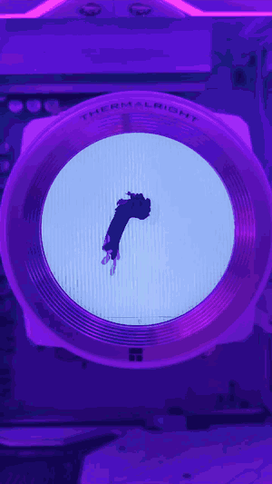
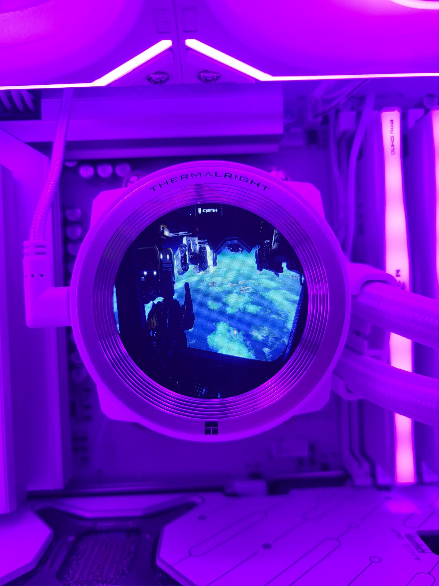

# ThermalRight-AIOMonitor

Turns the LCD on your Thermalright AIO into a second monitor.


Tested on a Thermalright Core Vision 360 at 480x480, about 13 fps.

## Media

[](docs/bad-apple.mp4)

*Of course I played Bad Apple on it.*



*Displaying Helldivers 2*

## Install

Download `ThermalRight.AIOMonitor.exe` from the
[releases page](https://github.com/BrokeSkill/ThermalRight-AIOMonitor/releases) and run it.

To build from source:

```
dotnet publish src/ThermalRight.AIOMonitor.Gui -c Release -r win-x64 --self-contained true -p:PublishSingleFile=true -o artifacts/publish
```

## Usage

Close TRCC first. It opens the panel exclusively, so nothing else can touch
the device while it runs.

```
ThermalRight.AIOMonitor.exe
```

Pick the panel, pick the monitor to mirror, press Start. The preview is drawn
at the panel's own resolution so you can see the crop before looking at the
cooler.

Headless:

```
ThermalRight-AIOMonitor [monitorIndex] [maxFps]
```

> [!WARNING]
> The panel needs a steady stream. It falls back to its own logo about a
> second after frames stop, so closing the app blanks it.

## How it works

The panel has no video input. It is a USB device that draws whatever you send
it.

```
CopyFromScreen -> BGRA -> resize to 480x480 -> JPEG -> USB bulk write
```

Each frame is a 64-byte header plus the payload: magic `12 34 56 78`, command
2 for JPEG or 3 for RGB565, width, height, payload length. One bulk transfer
per frame, endpoint 0x01 out and 0x81 in.

- `ThermalRight.AIOMonitor.Core` wire protocols, panel profile tables, pixel conversion,
  frame pacing. No Windows calls.
- `ThermalRight.AIOMonitor.Transport` detection and USB I/O through setupapi and winusb.dll.
- `ThermalRight.AIOMonitor.Capture` display enumeration and the screen grab.
- `ThermalRight.AIOMonitor.App` the pipeline between a panel and a monitor.
- `ThermalRight.AIOMonitor.Gui` the desktop app, `ThermalRight.AIOMonitor.Cli` the headless one.

## Panels

Detection goes by USB id, then by what the panel answers in its handshake, so
the resolution comes from the device instead of the id.

| USB id | Wire | Typical panel |
|---|---|---|
| 87CD:70DB | SCSI | 320x320 |
| 87AD:70DB | Bulk | 480x480 (Core Vision 360, GrandVision, Mjolnir, Hyper Vision, Peerless Vision) |
| 0402:3922 | SCSI | 320x320 (Frozen Warframe) |
| 0416:5406 | F5 | 320x320 (LC series) |
| 0416:5302 | HID type 2 | 240x240 to 1280x480 (Trofeo Vision, Frozen Warframe SE) |
| 0418:5303 | F5 | TARAN ARMS |
| 0418:5304 | F5 | TARAN ARMS |
| 0416:5408 | LY | Trofeo Vision 9.16 |
| 0416:5409 | LY1 | Trofeo Vision 9.16 |

The Core Vision 360 is the only one I have run this on. The rest come from the
protocol tables and are untested.

## What it does not do

It mirrors a monitor you already have. It does not give you a display you can
drag windows onto, because Windows cannot render to a USB panel directly. That
would need a virtual display driver, and there is not one in here.

SCSI panels are out too. Framing is written, the pass-through transport is
not. Capture uses `CopyFromScreen` rather than DXGI duplication, so protected
content arrives black.

## License

GPL-3.0. See [LICENSE](LICENSE).

It is GPL because the protocol knowledge comes from trcc-linux, which is
GPL-3.0 and reverse engineered Thermalright's own Windows binary.

Not affiliated with Thermalright. That is their trademark, used here only to
say what this is for.

## Credits

trcc-linux (Lexonight1) for the USB protocols and device tables:
https://github.com/Lexonight1/thermalright-trcc-linux
