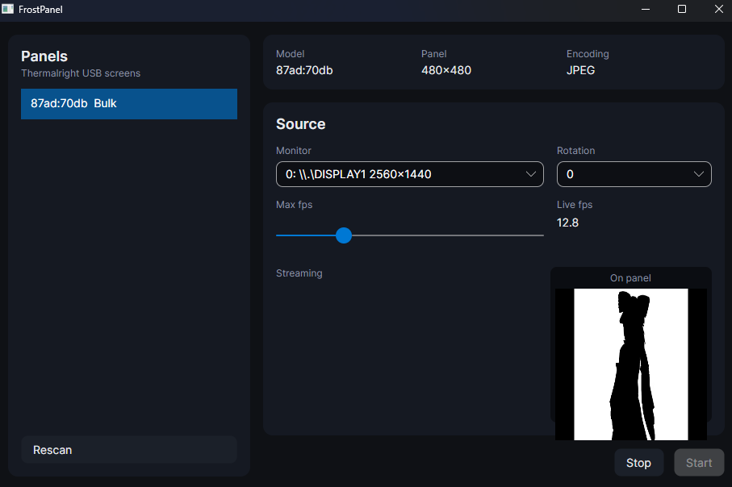

# FrostPanel

Puts your desktop onto a Thermalright USB AIO screen.

Pick a monitor, press Start, and whatever is on that monitor streams to the
cooler's LCD. The app shows a live preview of exactly what the panel is
getting.



Verified on real hardware: `87AD:70DB`, 480x480, JPEG, about 13 fps.

## How it works

The panel has no video input. It is a USB serial device that draws whatever
frames you send it, and it drops back to its own logo the moment the frames
stop. So FrostPanel grabs a monitor, encodes the frame the way the panel wants
it, and keeps sending without gaps.

```
monitor grab  ->  BGRA pixels
      |
   scale + rotate  ->  panel resolution
      |
   encode  ->  JPEG or RGB565
      |
   USB bulk  ->  the panel's own wire protocol
```

The frame is a 64-byte header then the payload: magic `12 34 56 78`, a command
byte (2 for JPEG, 3 for RGB565), width, height, and the payload length. One
bulk transfer per frame.

Four pieces:

- `FrostPanel.Core` the wire protocols, the panel profile tables, pixel
  conversion and frame pacing. Plain C#, no Windows calls.
- `FrostPanel.Transport` device detection and USB I/O straight through WinUSB
  (setupapi and winusb.dll). LibUsbDotNet enumerates nothing usable here.
- `FrostPanel.Capture` display enumeration and the monitor grab.
- `FrostPanel.App` the pipeline that ties a panel to a monitor.
- `FrostPanel.Gui` the desktop app. `FrostPanel.Cli` a headless driver.

## Requirements

- Windows 10 or 11, x64.
- A supported panel (see below).
- .NET 8 SDK, to build.

## Build

```
dotnet build
dotnet publish src/FrostPanel.Gui -c Release -r win-x64 --self-contained true -p:PublishSingleFile=true -o artifacts/publish
```

That gives one `FrostPanel.exe` you can move anywhere.

## Use

1. Close the Thermalright software (TRCC). It holds the panel exclusively.
2. Run `FrostPanel.exe`.
3. Pick your panel, pick the monitor to mirror, press Start.

The preview on the right is drawn at the panel's own resolution, so it shows
the real crop and squeeze. Live fps tells you what the panel sustains.

Headless:

```
frostpanel [monitorIndex] [maxFps]
```

## Supported panels

Detection is by USB id, then by the handshake the panel answers with, so the
model and resolution come from the device itself rather than the id alone.

| USB id     | Wire     | Typical panel |
|------------|----------|---------------|
| 87CD:70DB  | SCSI     | 320x320 |
| 87AD:70DB  | Bulk     | 480x480 (GrandVision, Mjolnir, Hyper Vision, Peerless Vision) |
| 0402:3922  | SCSI     | 320x320 (Frozen Warframe) |
| 0416:5406  | F5       | 320x320 (LC series) |
| 0416:5302  | HID type 2 | 240x240 to 1280x480 (Trofeo Vision, Frozen Warframe SE) |
| 0418:5303  | F5       | TARAN ARMS |
| 0418:5304  | F5       | TARAN ARMS |
| 0416:5408  | LY       | Trofeo Vision 9.16 |
| 0416:5409  | LY1      | Trofeo Vision 9.16 |

## Limitations

These are real and current.

- Close TRCC first. It holds the panel exclusively, so the app cannot open a
  device another program owns. It says so when the open fails.
- The stream must keep running. Stop it and the panel returns to its logo
  within a second. That is the panel, not a bug.
- SCSI panels are stubbed. The framing is written, the SCSI pass-through
  transport is not.
- Capture is GDI `CopyFromScreen`, not DXGI duplication. Simpler and
  dependency-free, fast enough for a panel that rarely clears 30 fps. Swap it
  if you see tearing or protected content.
- Refresh is low by nature. A 480x480 RGB565 frame is 460 KB; the JPEG path is
  far lighter. This is a glanceable second screen, not a gaming display.
- Only exercised on real hardware for `87AD:70DB`. Other entries come from the
  protocol tables and are untested here.

## License

GPL-3.0. See `LICENSE`.

The protocol knowledge comes from the trcc-linux project, which is GPL-3.0 and
decompiled Thermalright's own Windows binary. That is why FrostPanel is GPL too.

Not affiliated with or endorsed by Thermalright. "Thermalright" is their
trademark and appears here only to say what the software is for.

## Credits

- trcc-linux (Lexonight1) for the reverse-engineered USB protocols and the
  device tables. https://github.com/Lexonight1/thermalright-trcc-linux
- The Windows WinUSB API (setupapi and winusb.dll) for the USB layer.
